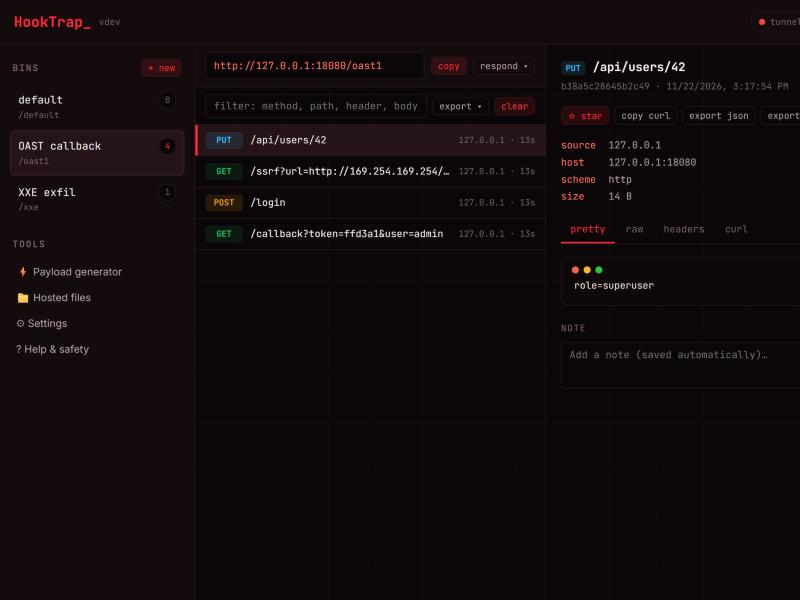
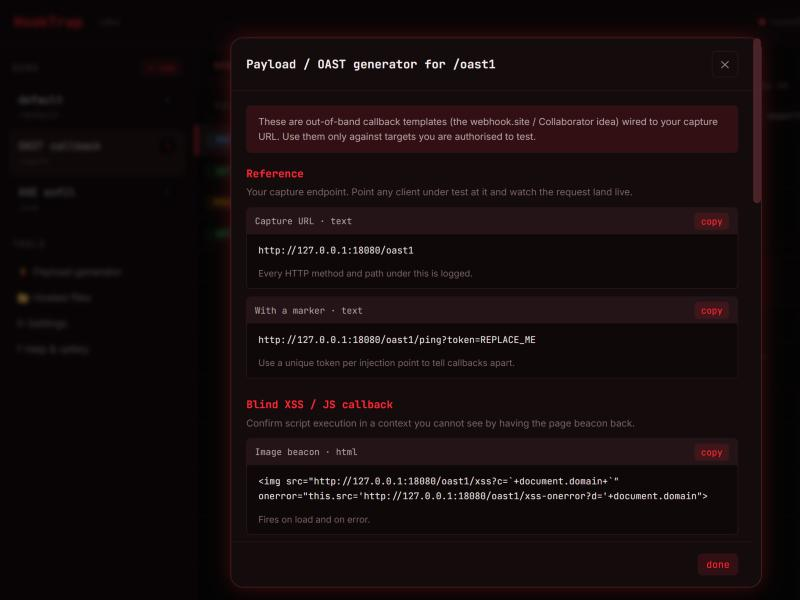

<div align="center">

# HookTrap

**A local, self-hosted request inspector — webhook.site without the website.**

Capture, inspect and respond to HTTP / DNS / raw-TCP callbacks on your own machine.
Built for authorised security testing, lab work and CTFs.



</div>

---

> ⚠️ **Use responsibly.** HookTrap is for inspecting traffic from systems you **own or are explicitly authorised to test** (your own apps, lab targets, CTF challenges). Capturing or soliciting traffic from systems you do not control may be illegal. You are responsible for how you use it.

## Why

Online request bins (webhook.site, RequestBin, Burp Collaborator) are great until you need to:

- work **offline** or inside an isolated CTF / lab network,
- keep captured data **on your own machine** instead of a third-party server,
- receive callbacks from a target that can only reach **your local network**, or
- script responses faster than a hosted UI allows.

HookTrap is a single compiled `hooktrap.exe` (no runtime, no dependencies) that gives you a live, themed dashboard and a capture endpoint you fully control.

## Features

| | |
|---|---|
| **Live capture** | Every HTTP request shown the instant it lands, over Server-Sent Events. Method, path, query, headers, body, source IP, uploaded files. |
| **Bins** | Named endpoints (`/<bin>` or `<bin>.host`). A catch-all `default` bin logs everything else. |
| **Scriptable responses** | Per-bin reply: status, headers, body, artificial delay, permissive CORS, `302` redirect (raw `Location`, SSRF-friendly), or **echo** mode that reflects the request as JSON. `{{ip}}`, `{{query}}`, `{{q:name}}`, `{{body}}`… placeholders. |
| **Payload / OAST generator** | One-click out-of-band callback templates (blind XSS, SSRF, OOB-XXE, DNS/TCP) wired to your capture URL — the Collaborator idea, offline. |
| **Hosted files** | Serve small fixtures/DTDs/JS at `/f/<name>`; each fetch is logged. |
| **DNS & raw TCP listeners** | Optional listeners make out-of-band DNS/TCP callbacks visible, not just HTTP. |
| **Export** | Any request as **curl**, raw HTTP, **JSON** or **HAR** (import into Burp / browsers). |
| **Public tunnel** | One click to expose the capture port via `cloudflared` (if installed) for remote targets. |
| **Local-only dashboard** | The UI binds to `127.0.0.1`; only the capture listeners face the network, and only if you choose `0.0.0.0`. |



## Install

**Windows** — download `HookTrap-x.y.z-Setup.exe` from the [latest release](https://github.com/ToaderMatei/hooktrap/releases/latest) and run it. Or grab the standalone `hooktrap.exe` and double-click it — no installation needed.

On launch, HookTrap starts the capture server and opens the dashboard at `http://127.0.0.1:8099`.

## Quick start

1. Launch HookTrap. The dashboard opens automatically.
2. Copy the **capture URL** shown at the top (e.g. `http://192.168.1.20:8080/default`).
3. Point whatever you're testing at it — a webhook, an SSRF sink, a blind-XSS beacon.
4. Watch requests arrive live. Click one to inspect headers/body, export as curl/HAR, or star it.
5. Open **Respond** to make the bin reply exactly how you need.

Use the **Payload generator** (sidebar) to get ready-made snippets for the current bin.

## Build from source

Requires **Go 1.23+**. On Windows:

```powershell
git clone https://github.com/ToaderMatei/hooktrap
cd hooktrap
.\build.ps1                 # -> dist\hooktrap.exe
.\build.ps1 -Installer      # also build the Setup.exe (needs Inno Setup 6)
```

Or plain Go, any platform:

```bash
go build -ldflags "-s -w -X main.version=1.0.0" -o hooktrap ./cmd/hooktrap
```

The dashboard is embedded into the binary — there is nothing else to ship.

### Command-line flags

```
hooktrap [flags]
  --http-port N     override the capture HTTP port
  --admin-port N    override the dashboard port
  --data DIR        data directory (default: per-user app data)
  --no-browser      do not open the dashboard on start
  --version         print version and exit
```

Settings (ports, bind address, body limits, DNS/TCP listeners, public URL) are editable in the dashboard's **Settings** panel and persist to `%APPDATA%\HookTrap\settings.json`.

## Project layout

```
cmd/hooktrap        entry point, listener wiring, CLI
internal/capture    HTTP capture handler, response engine, self-signed TLS
internal/listeners  optional DNS and raw-TCP capture
internal/store      in-memory + persisted bins and requests
internal/api        REST API, SSE stream, payload generator
internal/export     curl / raw / HAR / JSON exporters
internal/files      hosted-file store (/f/<name>)
internal/tunnel     cloudflared quick-tunnel integration
web/static          embedded dashboard (vanilla JS, no build step)
```

## Testing

```bash
go test ./...
go test -cover ./...
```

## License

[MIT](LICENSE) © 2026 Toader Matei ([m68k](https://toadermatei.github.io))
